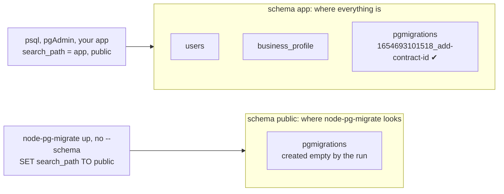
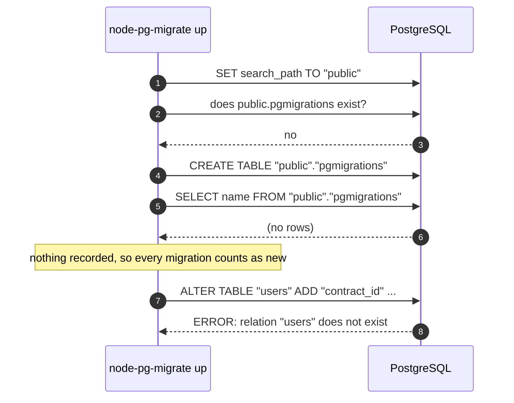

# node-pg-migrate #894: migrations that already ran are run again

A small, self-contained reproduction of
[salsita/node-pg-migrate#894](https://github.com/salsita/node-pg-migrate/issues/894),
_"Migration fails but query runs in pgadmin"_, on **node-pg-migrate 9.0.0**, the latest
release.

## In one paragraph

Your tables live in a schema called `app`, and so does node-pg-migrate's record of which
migrations have run (the `pgmigrations` table). Your database user's `search_path` points at
`app`, so psql and pgAdmin find everything. Then you run `node-pg-migrate up` without
`--schema`. It switches the connection to `public`, looks for `pgmigrations` there, finds
nothing, and concludes that no migration has ever run. So it **runs all of them again**, and
the first one that touches an existing table fails:

```
error: relation "users" does not exist
```

The same SQL works in pgAdmin, because pgAdmin still looks in `app`.

## Run it

You need Docker, Node.js 20.11 or newer, and bash (macOS, Linux, or WSL / Git Bash on Windows).

```bash
npm install
npm run reproduce
```

This starts a Postgres container on port `54894` and walks through the issue step by step. When
you are done:

```bash
docker compose down -v
```

## What you will see

**Step 1.** The first migration is applied with `--schema app`, so it is recorded in
`app.pgmigrations`. psql shows it, just like the reporter saw _"timestamps in the database"_:

```
$ psql -c "SELECT name, run_on FROM pgmigrations"
             name              |           run_on
-------------------------------+----------------------------
 1654693101518_add-contract-id | 2026-09-11 02:31:22.189699
```

**Step 2.** `node-pg-migrate up`, with no `--schema`. It lists the migration that already ran
as pending, runs it again, and fails. This is the first error from the issue:

```
$ node-pg-migrate up
> Migrating files:
> - 1654693101518_add-contract-id
> - 1654693101519_order-online-column
### MIGRATION 1654693101518_add-contract-id (UP) ###
ALTER TABLE "users"
  ADD "contract_id" varchar(255);
INSERT INTO "public"."pgmigrations" (name, run_on) VALUES ('1654693101518_add-contract-id', NOW());

Error executing:
ALTER TABLE "users"
  ADD "contract_id" varchar(255);
error: relation "users" does not exist
```

Note `"public"."pgmigrations"` in the `INSERT`: that is not where the history is.

**Step 3.** The history is still in `app`. The run created a second, empty migrations table in
`public`, which is why every later run without `--schema` replays everything again:

```
     table_name      | recorded
---------------------+----------
 app.pgmigrations    |        1
 public.pgmigrations |        0
```

**Step 4.** Like the reporter, set the old migration aside and try again. The new migration
fails the same way. This is the last output in the issue:

```
$ node-pg-migrate up --ignore-pattern '1654693101518.*'
> Migrating files:
> - 1654693101519_order-online-column
...
error: relation "business_profile" does not exist
```

**Step 5.** Point node-pg-migrate at the schema where the history lives, and only the migration
that is actually new runs:

```
$ node-pg-migrate up --schema app
> Migrating files:
> - 1654693101519_order-online-column
...
Migrations complete!
```

## What is going on

Two programs, one database, and each one looks in a different place:



Using `public` when `--schema` is not given is documented behaviour. The bug is what happens
next. node-pg-migrate never checks whether a migration history already exists somewhere else.
A missing or empty migrations table is taken to mean a brand-new database, and every migration
is replayed. Those migrations use unqualified names like `"users"`, which PostgreSQL now only
looks up in `public`.

It can also be worse than an error. If the replayed migrations _create_ tables instead of
altering them, nothing fails: you silently get a second copy of your schema in `public`.

How the history ended up in `app` does not matter much. Here it is an earlier run with
`--schema app`. In real projects it might be a flag or config value that was later dropped, a
reordered `--schema` list, or a role that has always pointed at its own schema. The run does
not check in any of these cases.

## Where it goes wrong in the code

What `node-pg-migrate up` does when `--schema` is not given (links go to the 9.0.0 source):



| #   | What happens                                                                                                                    | Code                                                                                                                                                                                                                                                                                  |
| --- | ------------------------------------------------------------------------------------------------------------------------------- | ------------------------------------------------------------------------------------------------------------------------------------------------------------------------------------------------------------------------------------------------------------------------------------- |
| 1   | No `--schema` was given, so the CLI fills in `public`                                                                           | [`bin/node-pg-migrate.ts#L515`](https://github.com/salsita/node-pg-migrate/blob/0d60e94fd2df1770f6578d8624a2ad7def22d35e/bin/node-pg-migrate.ts#L515)                                                                                                                                 |
| 2   | The runner sets it for the connection: `SET search_path TO "public"`. The role's `app, public` no longer applies to this session | [`src/runner.ts#L442-L456`](https://github.com/salsita/node-pg-migrate/blob/0d60e94fd2df1770f6578d8624a2ad7def22d35e/src/runner.ts#L442-L456)                                                                                                                                         |
| 3   | The migrations table is assumed to be in the first schema: `"public"."pgmigrations"`                                            | [`src/utils/getMigrationTableSchema.ts#L6`](https://github.com/salsita/node-pg-migrate/blob/0d60e94fd2df1770f6578d8624a2ad7def22d35e/src/utils/getMigrationTableSchema.ts#L6)                                                                                                         |
| 4   | It is not there, so an empty one is created. Nothing ever looks at `app.pgmigrations`                                           | [`src/runner.ts#L273`](https://github.com/salsita/node-pg-migrate/blob/0d60e94fd2df1770f6578d8624a2ad7def22d35e/src/runner.ts#L273), [`#L288`](https://github.com/salsita/node-pg-migrate/blob/0d60e94fd2df1770f6578d8624a2ad7def22d35e/src/runner.ts#L288)                           |
| 5   | Reading the history returns no rows                                                                                             | [`src/runner.ts#L312`](https://github.com/salsita/node-pg-migrate/blob/0d60e94fd2df1770f6578d8624a2ad7def22d35e/src/runner.ts#L312)                                                                                                                                                   |
| 6   | Every migration missing from that empty list is scheduled to run                                                                | [`src/runner.ts#L358`](https://github.com/salsita/node-pg-migrate/blob/0d60e94fd2df1770f6578d8624a2ad7def22d35e/src/runner.ts#L358)                                                                                                                                                   |
| 7   | The replayed `ALTER TABLE "users"` is looked up in `public` only, and fails                                                     | PostgreSQL                                                                                                                                                                                                                                                                            |

## Workaround

Tell node-pg-migrate where the history lives:

- `--schema app` (or `"schema": "app"` in your config) if your tables live there too.
- `--migrations-schema app` if only the `pgmigrations` table lives there.

## Status

- Bug report: [salsita/node-pg-migrate#894](https://github.com/salsita/node-pg-migrate/issues/894).
- Proposed fix: [salsita/node-pg-migrate#1729](https://github.com/salsita/node-pg-migrate/pull/1729).
  When the migrations table is missing or empty but another schema holds a history, the run is
  refused before it changes anything. The error names `"app"."pgmigrations"` and the option to
  use.

## Files

| File                                     | What it is                                                            |
| ---------------------------------------- | --------------------------------------------------------------------- |
| `db/init.sql`                            | The database before any migration: schema `app`, its tables, the role's `search_path` |
| `migrations/1654693101518_add-contract-id.js`    | The "old" migration from the issue                                    |
| `migrations/1654693101519_order-online-column.js` | The new migration from the issue, unchanged                          |
| `reproduce.sh`                           | Runs steps 1 to 5 above                                               |
| `docker-compose.yml`                     | Postgres 18 on port `54894`                                           |
